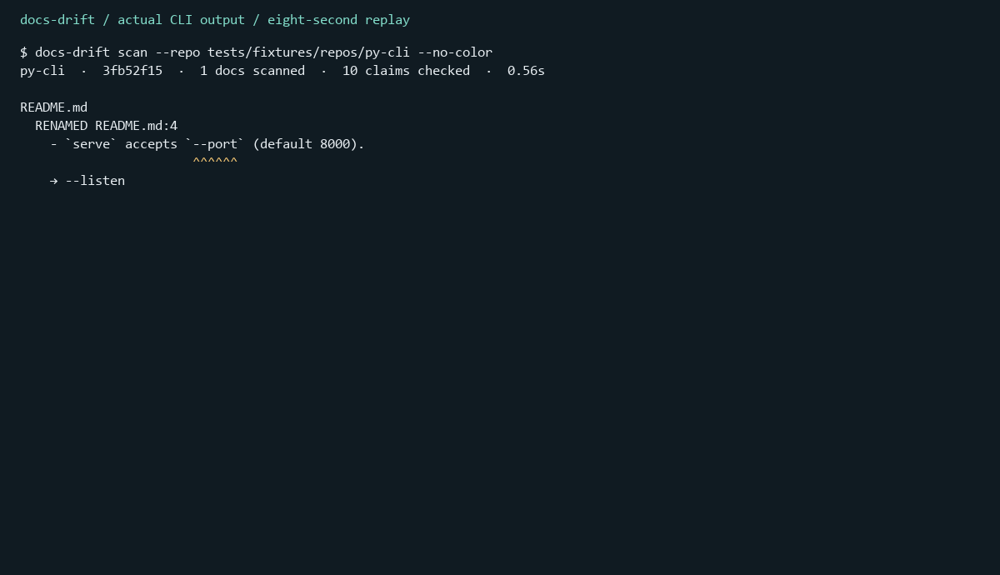
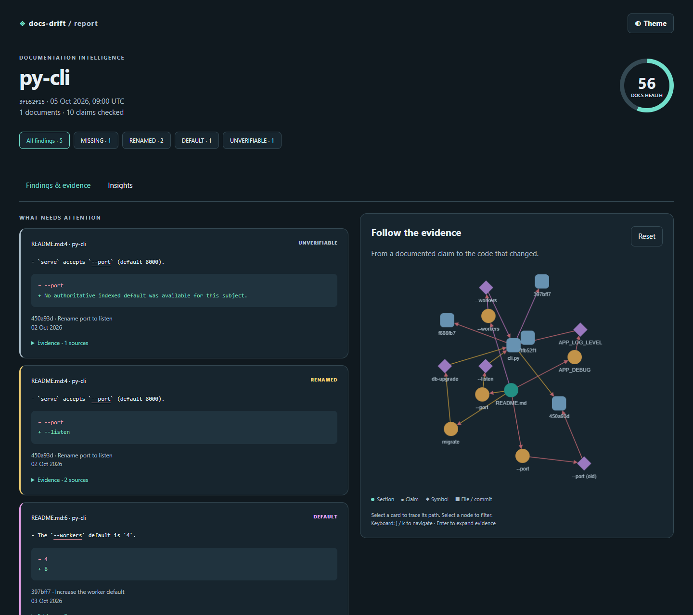
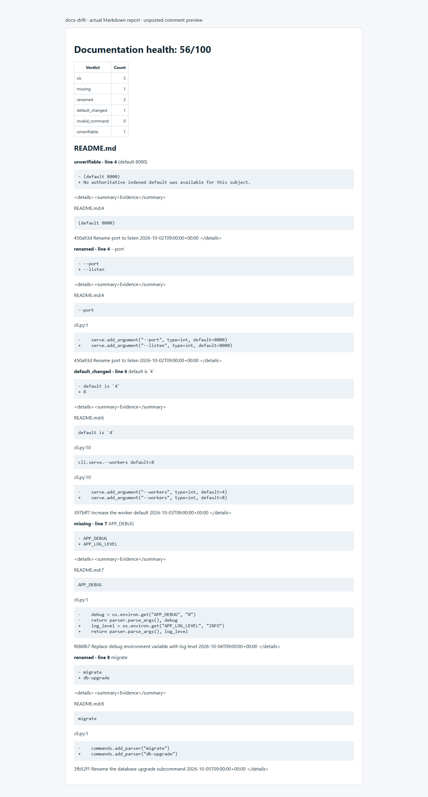
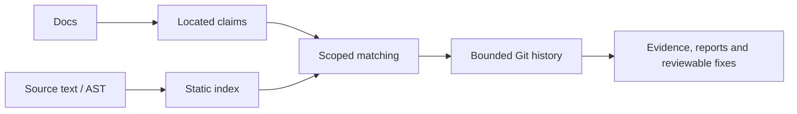
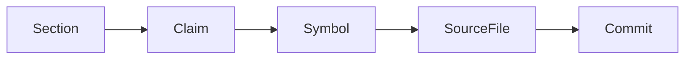

# docs-drift

Self-hosted documentation drift checks for maintainers: scan local repositories,
review source evidence, and gate newly introduced drift in CI. Organizations can
scan multiple checkouts into one dashboard with `docs-drift portfolio`.
[Organization adoption](docs/ORGANIZATIONS.md) · [Product maturity](docs/PRODUCT.md).

The product hypothesis is repeatable CI checks of exact documentation contracts
for SDK, CLI and API maintainers. Start external repositories in report-only mode:
real-world precision/recall and maintainer adoption remain unestablished.
[Run a frozen maintainer review](docs/MAINTAINER-PILOT.md) with blank human labels,
source evidence and an explicit decision about keeping it in CI.

## Judges start here

**Smallest offline demo:** [exact local run steps and one synthetic claim](docs/JUDGE-DEMO.md).
Open `/scan/example-judge` in the local app to inspect the source, rename commit,
and proposed documentation fix. Fixture results are not real-world accuracy measurements.

- **Public demo:** AWS deployment deferred by owner. Run the app locally on port 8080; no public URL is claimed. [AWS handoff](docs/AWS-HANDOFF.md).
- **Real case:** [reproduced rich-cli failure, source and commit](docs/REAL-CASE.md).
- **Try immediately:** the local app includes a repo URL scanner and precomputed real sample, with no sign-in or API key.
- **Interface:** monochrome themes, scroll-driven 3D evidence layers, motion controls and searchable reports; [UI verification](docs/UI-REVIEW.md).
- **Video:** pending owner recording and upload; target 1:50 with captions; [updated shot list](docs/FLOW-RECORDING.md).
- **Source:** [GitHub repository](https://github.com/ayushagarwalhere/docs-drift).
- **Evidence:** [benchmark results](benchmark/RESULTS.md),
  [measured limitations](docs/RESULTS.md), and [submission checklist](SUBMISSION.md).

Three-command local quick start (Python 3.11+, Git and uv installed):

```sh
git clone https://github.com/ayushagarwalhere/docs-drift.git
cd docs-drift
uv run --all-extras docs-drift scan --repo .
```

Release preparation: [owner's publish gates](RELEASING.md). Public installs and
URLs must be verified after approval; local checks do not prove a published release.

**Find documentation statements your code no longer supports, with source evidence and available Git history.**

[](.github/workflows/ci.yml)
**Package status:** PyPI unpublished (404 verified 22 October 2026); use the source quick start.
[](LICENSE)
[](pyproject.toml)

Alpha software: source installation works before the first package is published.
The PyPI page becomes available after the owner approves publication; the hosted
demo and video remain explicitly pending above. Real-world
precision and recall are **pending human labeling**, not inferred from fixtures.





## A real failure, reproduced during this build

To render rich-cli's README with line numbers, we followed its documented
`--line-number` option. It exited 2: "No such option." Source declares
`--line-numbers`, which exited 0. docs-drift locates README:61; manual Git
inspection identifies documentation commit `567f6c84`. The scanner does not
attribute a breaking commit for this finding. This is an agent-assisted build
investigation, not an invented account of the owner's earlier work.
[Exact snapshot, commands, source and review](docs/REAL-CASE.md).

The four-finding saved sample includes **two confirmed defects and two false
positives**. A fresh scan flags only the defective options. This selected,
agent-assisted review is not an independent human accuracy measurement.

The `--port` / `--listen` images above are synthetic fixtures, excluded from the
real case and review sample.

For beginners contributing to documentation, an evidence-backed finding can be a
concrete first contribution. Maintainers can use the same checks to keep docs
aligned with a changing codebase; the suggested patches still need review.

## Quick start

From this source checkout, with Python 3.11+ and Git:

```sh
uv sync --locked --all-extras
uv run docs-drift scan
```

After the first PyPI release, these are the intended package entry points:

```sh
pipx install docs-drift
docs-drift scan
# Alternative after publication:
uvx docs-drift scan
```

Or build the CLI container locally (Docker must be running):

```sh
docker build -t docs-drift:local . && docker run --rm -v "$PWD:/repo" docs-drift:local scan --repo /repo
```

Try it in your browser: AWS hosting is deferred by the owner. Locally,
start `uv run python -m docs_drift.web` and open `http://127.0.0.1:8080`; set
`DOCS_DRIFT_ALLOWED_ORIGIN` to that exact origin before submitting a scan.

Useful commands, exercised against a trusted fixture in CI:

```sh
docs-drift scan --no-color
docs-drift scan --format html --output scan.html
docs-drift insights --format json
docs-drift impact --base HEAD~1 --format json
docs-drift fix
docs-drift check  # documented exit: 1 on the stale py-cli fixture
```

`scan` reports findings and exits 0. `check` exits 1 for findings meeting its
threshold, or 2 for usage/configuration errors. `fix` previews a patch; applying
it requires an explicit write option and confirmation. No target code is run.

## What it checks (illustrative fixtures)

| Claim kind | Example documentation | Static evidence |
| --- | --- | --- |
| CLI flag / command | A synthetic README mentions `--port` | argparse/Click/Typer or Commander declarations |
| Environment variable | A synthetic README mentions `APP_LOG_LEVEL` | literal environment reads or safe config templates |
| Endpoint | A synthetic guide requests `GET /status` | literal FastAPI/Flask/Express routes |
| Setting / default | A synthetic guide says `workers` defaults to 4 | a recognized literal declaration/default |
| Code symbol | A synthetic guide calls `Client.connect()` | a parsed function/class/method declaration |
| File path | A synthetic guide links `config/settings.toml` | a contained repository-relative path |
| Package script / task | A synthetic guide invokes `npm run build` | package manifests and Make/just task declarations |
| Project command | A synthetic guide runs `tool serve --port 8000` | independently identified executable/command/flags |

Arbitrary behavioural prose is not proved by name matching. Optional model
assessment is separately labeled and constrained by source citations.

## Supported ecosystems

<!-- support-table:start -->
| Language | Framework / surface | Support |
| --- | --- | --- |
| Python | AST declarations | partial |
| Python | argparse | partial |
| Python | Click | partial |
| Python | Typer | partial |
| Python | FastAPI | partial |
| Python | Flask | partial |
| Python | Django / DRF | none |
| JavaScript / TypeScript | AST declarations | partial |
| JavaScript / TypeScript | Commander | partial |
| JavaScript / TypeScript | yargs | none |
| JavaScript / TypeScript | Express | partial |
| JavaScript / TypeScript | Next.js / NestJS routes | none |
| JSON / YAML / TOML / INI | literal settings | partial |
| Go / Rust | language-specific configuration | none |
<!-- support-table:end -->

Partial means recognized literal/static patterns, not complete framework support.
No framework is advertised as fully supported. Dynamic registration, signatures,
router composition and generated source may remain unverifiable.

## CI

This ten-line example uses the development Action from this repository:

```yaml
name: Documentation
on: [push, pull_request]
permissions: {contents: read}
jobs:
  docs:
    runs-on: ubuntu-latest
    steps:
      - uses: actions/checkout@d23441a48e516b6c34aea4fa41551a30e30af803
      - uses: ./
        with: {repo: '.', fail-on-drift: 'true'}
```

Other projects must replace the local action path with the real repository pinned
to a reviewed commit after publication. Reports include JSON, HTML, SARIF and
escaped Markdown. The Action needs no write token, accepts no model key, and never
posts a PR comment automatically. [Action guide](docs/github-action.md).



## Editor

The development VS Code extension supplies diagnostics, definitions and safe
quick fixes via the stdio LSP. **Actual squiggle GIF pending a verified editor
capture**; protocol tests are not presented as a native-editor recording.
[Extension guide](docs/vscode.md).

## How it works





Rules decide literal claims first. Optional model assessment handles selected
anchored prose, cannot override code-decided findings, and must cite supplied
source that passes validation.

## Accuracy and limitations

<!-- accuracy:start -->
Real-world accuracy is **not yet established**. The 12-repository protocol and
blank human labeling sheet are in [the benchmark](benchmark/PROTOCOL.md); its
[dated results](benchmark/RESULTS.md) keep precision/recall pending until the owner
labels them. Fixture scores establish plumbing, not product accuracy. Missing
findings can be intentional examples, third-party tools or indexing limitations;
review every report. [Known limitations](docs/LIMITATIONS.md).
<!-- accuracy:end -->

## Configuration

```toml
# .docs-drift.toml
min_confidence = 0.6
[history]
max_commits = 2000
```

The [full configuration reference](docs/configuration.md) is generated from the
Pydantic model and checked for freshness in CI. Common CLI options work before
or after subcommands. [CLI reference](docs/CLI.md).

## Privacy and security

Rule-only scans parse local text/AST and call Git for evidence. They never import
or execute target modules or fenced commands. Optional model mode sends selected
redacted documentation/source excerpts through OpenRouter to the chosen provider;
replay mode sends nothing. The public demo and composite Action are rule-only.
[Security policy](SECURITY.md) ? [Threat model](docs/SECURITY.md).

## Built with voice

The owner supplied original Flow usage cards, including **31,351 total words**,
**276 words/minute**, **11 apps**, and a **1-day streak**, plus a separate card
showing **26,412 total words**. These are account-level figures, not docs-drift
word counts. [Actual cards and provenance](docs/built-with-voice.md).

The specific dictated prompts, build revisions and Flow-use recording still need
owner evidence. [Concrete 1:50 recording plan](docs/FLOW-RECORDING.md). No personal
workflow or recording has been invented.

## Contributing and licence

See [CONTRIBUTING.md](CONTRIBUTING.md). Run tests, lint and type checks before
opening a change; do not change a frozen benchmark's rules or prefill human labels.
The code is [MIT licensed](LICENSE). [Changelog](CHANGELOG.md).
