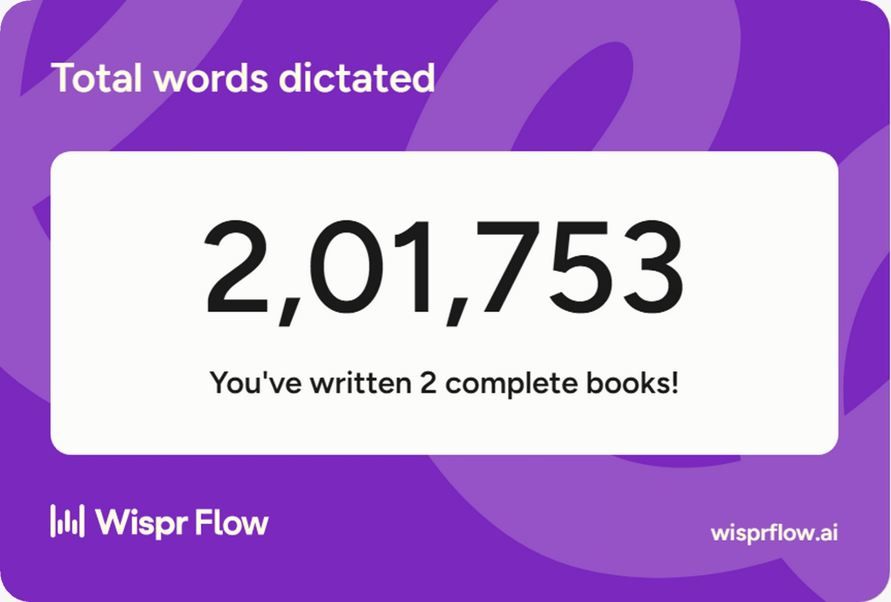
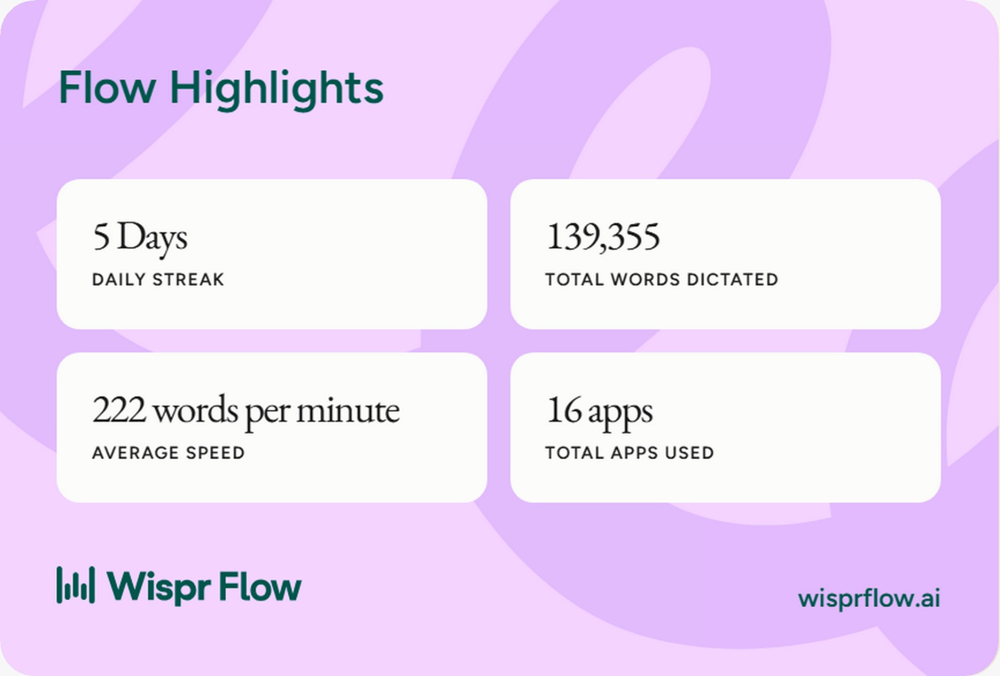
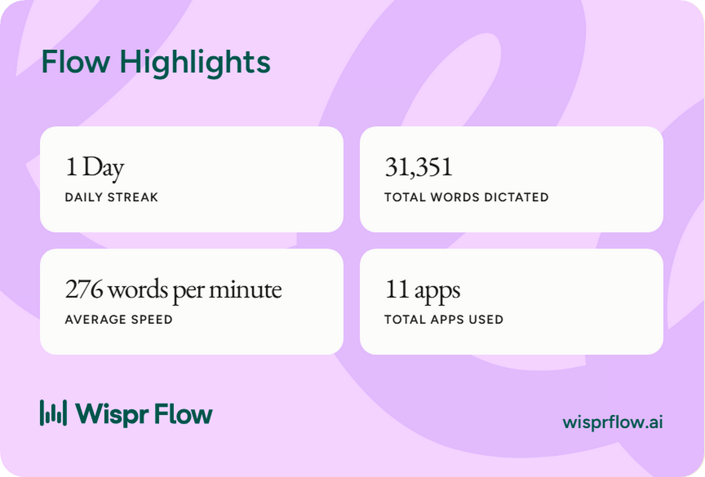
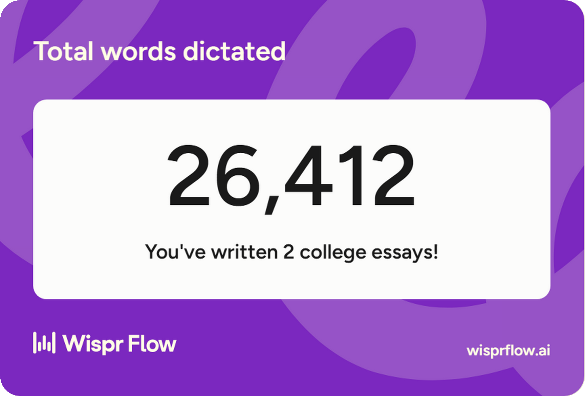

# Wispr Flow evidence

docs-drift was built for the WeMakeDevs × Wispr Flow "No Hands" challenge, with
requirements, prompts and docs dictated through Flow. Usage cards are shown as
supplied; hashes are in [provenance.json](assets/flow/provenance.json).

## Latest card — 27 October 2026

Challenge leaderboard on 27 October 2026: **5,07,100 words, rank #4** (owner-reported).
The card above shows 201,753 words dictated (2,01,753 in Indian notation).

## 25 October 2026

| Daily streak | Words dictated | Average speed | Apps used |
| --- | --- | --- | --- |
| 5 days | 139,355 | 222 wpm | 16 |

## Earlier cards — 22 October 2026

Between the 22 and 27 October cards the account total grew from 31,351 to
201,753 words. These are account-level totals across all apps, not a
docs-drift-only word count.

## Owner-reported project dictation: release preparation

On 23 October 2026 the owner supplied a release requirement in this coding session
and explicitly wrote, "i am giving this prompt through wispr". The
[original supplied text](assets/flow/dictated-release-request-2026-10-23.txt) is
preserved with its recognition errors and a SHA256 hash in
[provenance.json](assets/flow/provenance.json). This is owner-reported dictation;
no original audio/video was supplied for independent verification.

> Prepare and run the first public release.
>
> Walk me through the release step by step, stopping before any action that publishes something.

The requirement maps to the existing tag-derived version in `pyproject.toml`,
release workflow and [publishing guide](releasing.md). Follow-up changes refresh
the 0.1.0 user-facing notes, preserve the first TestPyPI RC requirement, allow
later stable releases from a single tag, and read packaged test assets from the
installed wheel. This is a release-preparation revision, not evidence that all
existing release infrastructure was created by this dictation.

The package and command are interpreted as `docs-drift`; "dogstrip" and other
recognition errors remain in the original text. A recording showing Flow input
and the final under-two-minute submission video remain pending.

## Organization workflow requirement

The owner requested package distribution, PR checks, scoped feedback, history,
ownership coverage and fix branches in the coding session on 23 October 2026.
The resulting [team workflows](TEAM-WORKFLOWS.md) are available for inspection.
The input method of that request is unverified; it is not labeled a dictated
transcript. The supplied account cards above remain the available Flow evidence.
A project-specific dictation recording is still pending owner capture.
