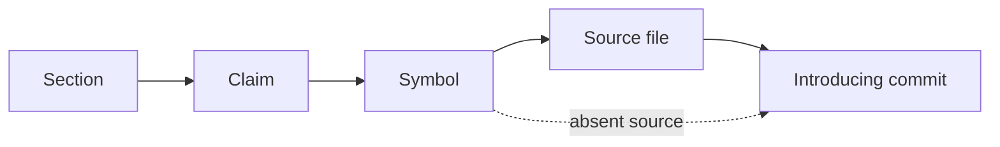

# Graph schema and queries



The HTML report uses a bounded Cytoscape graph. A missing symbol uses an old-name
placeholder; its route can go directly from that placeholder to a commit. Node IDs are stable claim/section/
symbol IDs or commit SHAs; edges retain the corresponding claim and verdict.
The web graph is capped at 200 nodes; the graph API export at 1,000, with a
`truncated` flag. Offline HTML and JSON exports are available without a database.
No FalkorDB-backed query server is implemented; the unused dependency was removed.

In the HTML report browser console, the actual Cytoscape instance is `cy`:

```javascript
cy.nodes('[kind = "claim"]')
cy.edges('[verdict = "renamed"]')
cy.nodes().filter(node => node.data('kind') === 'commit')
```

Click a finding to follow its evidence path. Filters, insights, keyboard selection,
and the graph are views of the same scan, not independent detectors.
