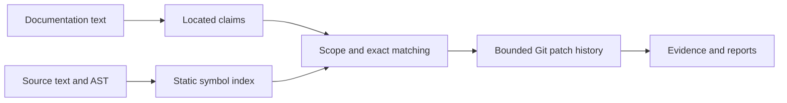

# How it works

Rules decide literal claims first. Optional model assessment handles selected
anchored prose and cannot override code-decided findings; it must cite supplied
source text that passes validation.

History reads one bounded newest-first patch stream, at most 2,000 commits and
8 MB/12 seconds per stream. Truncation is explicit. Warm scans reuse bounded,
snapshot-keyed Git text and source-index caches. Clear the local index cache
when investigating changed scanner behavior; public jobs trust neither cache
from a target repository.
