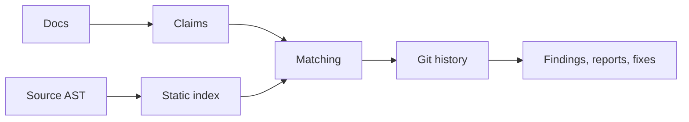

# docs-drift

**Find the lines in your docs that your code no longer supports, with the source line and commit that prove it.**

[](https://pypi.org/project/docs-drift/)
[](https://pypi.org/project/docs-drift/)
[](https://github.com/ayushagarwalhere/docs-drift/actions/workflows/ci.yml)
[](license.md)

A README says `--port`. The code was renamed to `--listen` three weeks ago. A new
contributor copies the command, it fails, and they decide your docs can't be
trusted. docs-drift catches that before they do. It reads your documentation,
indexes your source, and reports every flag, endpoint, environment variable,
setting and file path that no longer matches, with the commit that changed it.


## Install

```sh
pipx install docs-drift
docs-drift scan
```

Or run it once without installing: `uvx docs-drift scan`. Python 3.11+ and Git required.

## A real catch

rich-cli's README told users to run `rich README.md --line-number`. That fails
with `No such option '--line-number'` (exit 2): the Click declaration is
`--line-numbers`. docs-drift points to
[README.md:61](https://github.com/Textualize/rich-cli/blob/46f4d2469097be395558768714a5f07ebccf1412/README.md#L61)
and the [declaration](https://github.com/Textualize/rich-cli/blob/46f4d2469097be395558768714a5f07ebccf1412/src/rich_cli/__main__.py#L358).
[Full investigation, including the false positives in that scan](REAL-CASE.md).

## What it checks

| Claim in your docs | Checked against |
| --- | --- |
| CLI flags and commands (`--port`, `tool serve`) | argparse, Click, Typer and Commander declarations |
| Environment variables (`APP_LOG_LEVEL`) | literal environment reads and config templates |
| HTTP endpoints (`GET /status`) | FastAPI, Flask and Express routes |
| Settings and defaults ("`workers` defaults to 4") | literal declarations and defaults |
| Code symbols (`Client.connect()`) | parsed functions, classes and methods |
| File paths (`config/settings.toml`) | files in the repository |
| Package scripts (`npm run build`) | package manifests, Make and just tasks |

Every finding carries a verdict (`missing`, `renamed`, `default_changed`,
`invalid_command`, `unverifiable`), a confidence score, the source evidence and,
where Git history allows, the commit that introduced the drift.

## Commands

```sh
docs-drift scan                             # report findings, exit 0
docs-drift check                            # exit 1 when findings meet your threshold
docs-drift fix                              # preview a patch; --write applies it
docs-drift insights                         # findings by verdict, document and package
docs-drift impact --base HEAD~1             # findings touched by recent changes
docs-drift pr --base HEAD~1 --report-dir pr  # review artifacts for drift a branch introduces
docs-drift baseline update                  # accept today's drift, gate only new drift
docs-drift scan --format html --output report.html
```

`docs-drift explain <finding-id>` shows the docs, source, reasons and history
behind one finding.

Reports: terminal, JSON, HTML (with an evidence graph), Markdown, SARIF, JUnit
and GitHub annotations. [Full CLI reference](CLI.md).


## CI

```yaml
name: docs
on: [pull_request]
permissions: {contents: read}
jobs:
  drift:
    runs-on: ubuntu-latest
    steps:
      - uses: actions/checkout@v4
        with: {fetch-depth: 0}
      - uses: ayushagarwalhere/docs-drift@v0.1.0
        with:
          base-ref: origin/${{ github.base_ref }}
          fail-on-drift: 'true'
```

With `base-ref`, the gate fails only on drift the pull request introduces.
Reports are written as JSON, HTML, SARIF and Markdown. [Action guide](github-action.md).

## Editor

The VS Code extension shows findings as diagnostics, jumps to the source
declaration, and offers quick fixes, backed by `docs-drift lsp`.
[Extension guide](vscode.md).

## How it works



1. Markdown, RST and MDX are parsed into located claims.
2. Source is parsed with Python's `ast` and tree-sitter (JS/TS) into an index of
   declarations. Your code is never imported or executed.
3. Each claim is matched to the index; renames are detected by similarity and history.
4. Git history finds the commit where a symbol disappeared or changed.

An optional model mode can assess prose claims, but it cannot override a finding
the rules already decided, and every answer must cite source that passes validation.
[Design notes](how-it-works.md).

## Supported ecosystems

<!-- support-table:start -->
| Language | Framework / surface | Support |
| --- | --- | --- |
| Python | AST declarations | partial |
| Python | argparse | partial |
| Python | Click | partial |
| Python | Typer | partial |
| Python | FastAPI | partial |
| Python | Flask | partial |
| Python | Django / DRF | none |
| JavaScript / TypeScript | AST declarations | partial |
| JavaScript / TypeScript | Commander | partial |
| JavaScript / TypeScript | yargs | none |
| JavaScript / TypeScript | Express | partial |
| JavaScript / TypeScript | Next.js / NestJS routes | none |
| JSON / YAML / TOML / INI | literal settings | partial |
| Go / Rust | language-specific configuration | none |
<!-- support-table:end -->

"Partial" means static, literal patterns. Dynamic registration and generated
code can be reported as unverifiable rather than guessed.

## Accuracy

<!-- accuracy:start -->
Real-world accuracy is **not yet established**. The 12-repository protocol and
blank human labeling sheet are in [the benchmark](benchmark.md); its
[dated results](benchmark.md) keep precision/recall pending until the owner
labels them. Fixture scores establish plumbing, not product accuracy. Missing
findings can be intentional examples, third-party tools or indexing limitations;
review every report. [Known limitations](LIMITATIONS.md).
<!-- accuracy:end -->

## Configuration

```toml
# .docs-drift.toml
min_confidence = 0.6

[history]
max_commits = 2000
```

[Configuration reference](configuration.md), generated from the settings model.

## Privacy and security

Rule-based scans parse text and syntax trees locally and call Git for history.
They never import or execute the scanned code, and make no network calls. Model
mode is opt-in, sends only redacted excerpts, and can be replayed offline.
[Security policy](SECURITY.md) · [Threat model](SECURITY.md).

## Try it in the browser

The web app scans a public GitHub repository without sign-in, and includes saved
reports you can open instantly. Run it locally:

```sh
uv run --all-extras python -m docs_drift.web   # http://127.0.0.1:8080
```

## Built with voice

docs-drift was built for the WeMakeDevs × Wispr Flow "No Hands" challenge, with
requirements, prompts and docs dictated through Wispr Flow.
[Flow usage evidence](built-with-voice.md).

## Contributing

See [contributing.md](contributing.md). Run tests, lint and type checks before
opening a change. MIT licensed. [Changelog](CHANGELOG.md).
